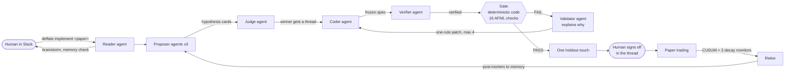

# Deflate

**A quant research floor on [Switch](https://switchagents.ai). Agents propose strategies, deterministic code decides if they are real, and a human signs off in Slack.**

Built for WeMakeDevs "Flip the Switch", Track 01 (Business Workflow).

| | |
|---|---|
| **Demo video** (under 3 min) | _link to be added_ |
| **Landing page** | https://atharvamaskar.github.io/quant-swarms-switch-hackathon/ |
| **Research floor** (frozen snapshot of today's run) | https://atharvamaskar.github.io/quant-swarms-switch-hackathon/floor/ |
| **Where it runs** | Slack, one channel `#deflate-control`, through Switch's Slack bridge |
| **Agents** | 8 Claude Code agents on Switch + 1 deterministic orchestrator registered as a Switch agent |

---

## Contents

1. [The problem](#1-the-problem)
2. [What Deflate does, in one picture](#2-what-deflate-does-in-one-picture)
3. [A real example from today's run](#3-a-real-example-from-todays-run)
4. [How Switch is used](#4-how-switch-is-used)
5. [How the loop works](#5-how-the-loop-works)
6. [Results so far](#6-results-so-far)
7. [Run it yourself](#7-run-it-yourself)
8. [Commands you type in Slack](#8-commands-you-type-in-slack)
9. [Reference: the gate, costs and data](#9-reference-the-gate-costs-and-data)
10. [Limitations](#10-limitations)
11. [Acknowledgements](#11-acknowledgements)

---

## 1. The problem

I'm an AI and quant engineer. I build ML and quant trading algorithms for retail and HNI investors in the Indian markets. Two things have changed in the last year.

**Alpha decays in days, not months.** Strategy code is nearly free now. Big firms have put AI agents into their daily workflow, so any edge gets found, copied and arbitraged away fast. By the time you've implemented an idea and convinced yourself it's real, it's mostly gone.

**AI swarms make false discoveries cheap.** The more strategies you try, the higher the best backtest you'll find by pure luck (López de Prado, *Advances in Financial Machine Learning*, §11.3). A swarm that tries thousands of ideas will always find one that looks amazing. A leaderboard of machine-generated strategies mostly ranks noise.

I learned this the hard way. My previous research swarm produced **259 candidates and promoted 0**:

- Train rankings flipped on the holdout. A long bias in a rising market looked like skill.
- The holdout was spent on ten contenders at once.
- 728 earlier trials were never counted when deflating the Sharpe ratio.
- Agents could reach and rewrite the rules that judged them.
- The swarm drifted into building statistics tools instead of testing strategies.

There is also a personal version of the problem. Every paper I read gives me ten tangents, and at least nine of them are dead ends. Chasing them by hand costs months.

**Producing ideas is no longer the bottleneck. The bottleneck is deciding, honestly and quickly, which ideas are real, and noticing when a real one stops working.**

## 2. What Deflate does, in one picture



1. **Agents propose.** Three proposers (literature, post-mortems, contrarian) and a paper reader write five-slot hypothesis cards. A judge ranks them pairwise.
2. **Code decides.** A deterministic gate that agents cannot edit runs AFML checks on a frozen spec. Every run is a counted trial, forever.
3. **Humans sign off.** A gate pass gets exactly one holdout touch. Then a named human approves or rejects it in the hypothesis's Slack thread.
4. **Paper trading.** Approved strategies run the same engine and spec on a live (replayed) tick feed.
5. **Decay retires.** CUSUM, Chu-Stinchcombe-White, Lempel-Ziv entropy and rolling PSR watch the paper P&L. Two alarms in 10 sessions retire the strategy.
6. **Learnings fork.** Dead ends and retired strategies write post-mortems to memory and can fork new hypotheses. A fork inherits its family's trial count, so the bar never resets.

**The rule that holds it together: an LLM never decides whether a strategy is real.** Agents talk, write and explain. Every verdict, budget and stop is code.

## 3. A real example from today's run

Today the agents tested **8 strategies, and all 8 failed the gate.** That is expected, and it is the point: I'd rather get the reality check here than in live markets.

**h7 · red-day rebound** (proposed by the contrarian agent). The worst days for intraday buy-and-hold are big open-to-close sell-offs, but the next session often looks very different. The agent's quick scan said: after a day that closes down 1% or more from the open, the next session averaged about +20 basis points, and it was positive in all five years from 2022 to 2026. On paper it looked great. But it had only **49 trades** in the research window, and the card's own kill rule said fewer than 50 trades means stop. The gate rejected it. No agent gets to argue its way past that.

**h8 · wide-day fade**, in its Slack thread, step by step:

| Who | What happened in the thread |
|---|---|
| orchestrator | Opens `🧪 h8 · wide-day-fade` and asks `@coder` for a spec |
| coder | Writes `specs/h8.yaml` from the card and posts `deflate freeze h8 specs/h8.yaml` |
| orchestrator | Hashes and freezes the spec, asks `@verifier` to check it against the card |
| verifier | "spec matches card" → `verified h8 round 1` |
| orchestrator | Runs the trial through the gate and posts the receipt: **FAIL**, with every check and the config sha |
| validator | Explains in plain language which checks failed and why |
| coder | Files a one-rule patch, or the line stops at the hard stop |

**A paper thread.** A researcher posts `deflate implement https://arxiv.org/abs/2103.09692` (Bouchaud, *Radical Complexity*). Within a second the orchestrator opens a thread, parses the paper from its LaTeX source (equations included) and briefs the reader. The reader reads it, checks memory ("no dead ends yet, nearest cards are h1 and h2"), writes a paper card, and asks the human one steering question with options (a) futures gate, (b) options straddle, (c) park the paper. Nothing is proposed until the human answers.

## 4. How Switch is used

Switch is the backbone, not a notification channel. Take it away and the agents, the hand-offs, the orchestrator's input and output, the sign-off and Slack all stop.

### Which agents are connected

| Agent | Kind | Job |
|---|---|---|
| `proposer-card` | Claude Code on Switch | Proposes hypotheses from unread literature cards |
| `proposer-lead` | Claude Code on Switch | Proposes from recent post-mortems and learnings; writes post-mortems |
| `proposer-contrarian` | Claude Code on Switch | Proposes from the periods where the reference rules lost |
| `judge` | Claude Code on Switch | Compares two cards and replies with a JSON preference. Never judges truth |
| `reader` | Claude Code on Switch | Reads arXiv/SSRN papers, runs memory queries, brainstorms with the human, then proposes |
| `coder` | Claude Code on Switch | Writes the frozen strategy spec (`specs/<hid>.yaml`) and one-rule patches |
| `verifier` | Claude Code on Switch (Sonnet) | Checks the spec matches the card before the gate runs |
| `validator` | Claude Code on Switch (Sonnet) | Explains gate verdicts in plain language. Never computes them |
| `orchestrator` | **Our own Python process**, registered as an `always_on` Switch agent | The deterministic state machine: budgets, naming, freeze, gate runs, hard stops, sign-off |

All eight Claude Code agents are created in one click from a Switch v2 agent template (`templates/deflate-agents.v2.yaml`). Each one reads its brief from `agents/*.md`, works in this repo, and is told never to edit `qs/`, `config/`, `ref/` or any database. An engine-integrity check refuses to run a trial if those files differ from the committed ref anyway.

### How the channel is set up

- **One Slack channel, `#deflate-control`**, created on first run from a Switch v2 room template (`templates/control-room.v2.yaml`) on the Slack bridge. Every agent, the orchestrator and the human are in it, each with a Switch role (`proposer`, `judge`, `coder`, `verifier`, `validator`, `reader`).
- **Each hypothesis is a thread**, for example `🧪 h2 · vix-gated-drift`. Spec, freeze, verify, gate receipt, patches, hard stop and sign-off all happen inside it.
- **Each paper is a thread** under the human's `deflate implement …` message. The reader brainstorms there.
- **Forks carry lineage in the thread title**, for example `🧪 h1.1 · expiry-volgate · forked from h1`.
- **The paper desk reports in the hypothesis thread**: fills, daily P&L, decay alarms, retirement.

Hundreds of strategies can't mean hundreds of channels, so the hierarchy (families, patches, forks, trial counts) lives in `research.db` and in Switch threads, not in channel names. A channel-per-hypothesis mode still exists (`QS_THREADS=0`), but we don't use it.

### Which Switch features do the work

| Switch feature | What Deflate does with it |
|---|---|
| **v2 room template** (`templates/control-room.v2.yaml`) | Creates `#deflate-control` with every role on the bridge named by `QS_BRIDGE` |
| **v2 agent template** (`templates/deflate-agents.v2.yaml`) | Creates all eight Claude Code agents with their briefs in one click |
| **Roles** | Each agent gets role instructions from the template |
| **Threads** (`post_message` with `thread_id`) | One thread per hypothesis and per paper. Room ids are `"<channel>#<thread root>"`, so every post and @-mention lands in the right thread |
| **Registered `always_on` agent over HTTP + SSE** | The orchestrator listens to **all** room messages on `GET /agents/{id}/events` and acts only through `POST /agents/{id}/ops/{op}` (post, mention, thread, create room, read context, download media) |
| **@-mention hand-offs** | Every step is an @-mention: `@coder` builds, `@verifier` checks, `@validator` explains, `@judge` compares, `@proposer-lead` writes the post-mortem |
| **Sender identity** | Only humans named in `--humans` can `approve`, `reject`, `close`, `stop` or `resume`, checked against the sender Switch reports. Each decision is stored as calibration data |
| **Media store** | SSRN papers arrive as a PDF attached in the thread; the orchestrator pulls it on `deflate attach <lit_id>` |
| **Slack bridge** | The only UI. We wrote no Slack bot |

### What breaks without Switch

1. **The agents.** Nothing creates them, wakes them or gives them a room.
2. **Hand-offs.** Every step is an @-mention routed by Switch. There is no queue, no RPC and no other channel between agents.
3. **The orchestrator.** It has no API of its own. Its only input is Switch's event stream and its only output is Switch ops.
4. **Human sign-off.** It is checked against the sender Switch reports. There is no other place to sign off.
5. **Slack.** The channel and its threads exist only through Switch's Slack bridge.
6. **The floor's live view.** The research floor reads which agents are live and every thread's discussion from Switch.

What survives without Switch: the engine, the gate, `research.db` and the leaderboard. That's a backtester, not a research floor.

### How teammates work with it

They just talk in Slack. They drop papers with `deflate implement`, answer the reader's questions, read gate receipts in the threads, and sign off with `deflate approve` or `deflate reject`. Anyone who doesn't want to scroll Slack opens the **research floor**: one screen with the pipeline board, every strategy tested, the agent teams, the papers, and a drawer per hypothesis showing its card, frozen spec, every trial receipt and the thread's discussion read live from Switch.

## 5. How the loop works

### Architecture

```
  +----------------------- Switch (Slack bridge, QS_BRIDGE) ------------------------+
  |  #deflate-control  (proposers, judge, reader, coder, verifier, validator,       |
  |                     orchestrator, human)                                        |
  |    ├─ thread 🧪 h1 · late-day-momentum      spec, gate receipt, patches, stop   |
  |    ├─ thread 🧪 h1.1 · … · forked from h1    lineage in the title               |
  |    ├─ thread under "deflate implement <arXiv>"  paper card, reader brainstorm   |
  |    └─ paper desk posts in the hypothesis thread (fills, P&L, decay, retire)     |
  +---------------^-----------------------------------------^-----------------------+
                  | agent protocol (HTTP + SSE)             |
     +------------+--------------------+          +---------+-------------+
     | Orchestrator qs/orchestrator.py |          | Paper desk (qs/paper) |
     | state machine, budgets, naming, |          | TBT replay feed, same |
     | hard stops, kickoffs, sign-off  |          | engine, decay monitors|
     +------+---------------+----------+          +-----------+-----------+
            |               |                                 |
     +------v-----+  +------v--------------+  +---------------v---------+
     | Engine     |  | Gate (qs/gate)      |  | SQLite research.db      |
     | spec->bars |  | read-only to agents,|  | append-only (triggers): |
     | ->fills    |  | config sha in every |  | trials, messages, specs |
     | ->net P&L  |  | verdict             |  | frozen, holdout once    |
     +------------+  +---------------------+  +------------+------------+
                                                           |
                               qs.web leaderboard :8765 · floor/ research floor :8766
```

**Deterministic (our code):** orchestrator, engine, gate, cost model, database, trial runner, paper desk, decay monitors, dashboards.
**LLM (Claude Code agents):** proposing, critiquing, ranking ideas, writing specs, explaining results, post-mortems.

### The rules the orchestrator enforces

- **Every trial counts, forever.** The trial count feeds the deflated Sharpe ratio (DSR) and the probability of backtest overfitting (PBO). Forks inherit their family's count.
- **One rule per patch.** A failed hypothesis may file a patch (`h12v2`) that changes exactly one rule, enforced as a structured diff. A patch that changes two rules is refused in the thread.
- **Hard stop.** A patch line stops at 4 patches, 2 non-improving patches, or when DSR is unreachable at the family's trial count, whichever comes first. A human can also end it early with `deflate close`.
- **One holdout touch.** The holdout window is touched once per strategy, enforced by a unique index in SQLite.
- **The gate is read-only.** Thresholds live in `config/gate.yaml`, which is sha256-hashed. The hash is stamped on every verdict, so a changed threshold shows on every receipt.
- **Human sign-off only.** Agents cannot approve, reject, stop or resume anything.

## 6. Results so far

- **The real gate rejected everything we tried.** Today's run: 8 strategies tested across 9 families, **0 passed**. Best Sharpe 0.13 against a luck line of 1.32 (the best Sharpe you'd expect from noise at this trial count).
- **The prior project's 987 trials** (728 + 259) are reported on the floor but not counted, because they were run under different rules.
- **An earlier 8-trial counted search** (`research.demo-search.db`, `specs/demo/`) found nothing that passes even the looser demo gate. The closest, h1.2.3 gap continuation in calm regimes, had DSR 0.44, PBO 0.65, 79% of its P&L in its top 5 days, and a storytelling clause the ablation caught.
- **Calibration:** no-skill fixtures (random entries, pure long exposure, a planted look-ahead leak, the best of 100 random strategies) were rejected 100% on real data.

A gate that says no to everything a day of research produced is the product working.

**The demo gate, honestly.** A real-gate pass is rare by design. To show the whole loop (sign-off → paper → decay → retire), `config/gate.demo.yaml` runs the same checks with looser thresholds (PSR/DSR 0.50, PBO 0.50, CPCV 50% positive, 20 bets). Every verdict, post and leaderboard row from it is stamped **DEMO GATE (looser thresholds)**, with the real-gate verdict shown next to it. Nothing passed the demo gate either.

## 7. Run it yourself

**Requirements:** Python 3.12+, [uv](https://docs.astral.sh/uv/), Node 20+, a Switch Console server, and a Slack workspace where you can install an app. If the shared uv cache is locked, prefix `uv` commands with `UV_CACHE_DIR=/tmp/uv-cache`.

**Step 1. Python environment and data**

```bash
uv sync
uv run python scripts/build_data.py   # see "Data" below to use your own files
uv run pytest -q
```

**Step 2. Switch.** Run the Switch Console local server on a free port (3000 is often taken). Console v0.40.1 has no API Keys screen: the registration token is the server's `AGENT_REGISTRATION_TOKEN`, in its `run/switch-core.env`.

**Step 3. Slack.** Create the Slack app from Switch's manifest. For a company workspace, delete the `agent_view` block from the manifest first. Connect it in Console as a bridge. The connection's name is what goes in `QS_BRIDGE`.

**Step 4. `.env`** (gitignored):

```bash
SWITCH_URL=http://localhost:3100
SWITCH_REG_TOKEN=...                 # the server's AGENT_REGISTRATION_TOKEN
QS_BRIDGE="My Company Slack"         # the Slack connection's name; quote values with spaces
QS_ENGINE_REF=feat/deflate           # engine-integrity check compares qs/, config/, ref/ to this ref
QS_THREADS=1                         # default: one channel, a thread per hypothesis/paper
QS_CHANNEL_PREFIX=deflate-           # prefix for every channel Deflate creates
```

**Step 5. Register the orchestrator** as an `always_on` agent. This writes `SWITCH_AGENT_ID` and `SWITCH_API_KEY` to `.env`.

```bash
set -a; source .env; set +a
uv run python scripts/switch_register.py
set -a; source .env; set +a
```

**Step 6. Create the agents.** In Console → Templates, create all eight from `templates/deflate-agents.v2.yaml` in one click. If a partial run already created some, use `templates/deflate-agents-rest.v2.yaml` for the rest.

**Step 7. Run the orchestrator.** It creates `#deflate-control` on first run, pins it, and replays any backlog.

```bash
uv run python -m qs.cli run-orchestrator --humans "<Slack display name>"          # real gate
uv run python -m qs.cli run-orchestrator --humans "<Slack display name>" --demo   # stamped demo gate
```

**Step 8. Dashboards and landing page**

```bash
uv run python -m qs.web              # leaderboard, http://127.0.0.1:8765
uv run python -m floor.server        # research floor, http://127.0.0.1:8766
cd landing && npm install && npm run dev
bash scripts/deploy_pages.sh         # publish landing + a frozen floor snapshot to GitHub Pages
```

**Step 9. Try it.** In `#deflate-control`, post `deflate implement https://arxiv.org/abs/2103.09692` and answer the reader when it asks you a question.

Other commands: `qs.cli calibrate [--demo]`, `qs.cli trial <hid> [--demo]`, `qs.cli leaderboard`, `qs.cli demo-seed` (three sample cards), `qs.cli memory search|show|deadends|features`, `qs.cli paper fetch <url>`.

**Mattermost** also works as a bridge (`QS_BRIDGE` names it), but its container ran out of memory under emulation on Apple Silicon, so we moved to Slack.

## 8. Commands you type in Slack

Send these in `#deflate-control` or in any Deflate thread. Every command works as `deflate <cmd> …` (preferred) or `@orchestrator <cmd> …`.

Why `deflate` first: the orchestrator is registered with Switch's bootstrap registration token, so Switch auto-replies "not permitted" to @-mentions of it. The orchestrator still hears every room message and acts on the command, but `deflate …` avoids the noise.

| Message | Who | Effect |
|---|---|---|
| `deflate implement <arXiv/SSRN url or id>` | anyone | Open a paper thread. arXiv: LaTeX source parsed with exact equations. SSRN: the orchestrator asks you to attach the PDF |
| `deflate attach <lit_id>` | anyone | Read the latest PDF attached in that paper thread |
| `@reader propose` | human, in a paper thread | The reader posts its cards as `deflate propose {…}` |
| `deflate propose {card JSON}` | proposers, reader | Register a card; it gets filtered, judged and ranked |
| `deflate h12 round 3: {"prefer": "A", "reason": "…"}` | judge | Pairwise verdict; the winner gets a thread |
| `deflate freeze h12 specs/h12.yaml` | coder | Hash and freeze the spec, then ask the verifier |
| `verified h12 round 3: <note>` | verifier | Run the research trial through the gate |
| `deflate approve h12` | humans only | Sign off and start the paper desk, which reports in the hypothesis thread |
| `deflate reject h12 <note>` | humans only | Reject; the note is stored as calibration |
| `deflate close h12 <note>` | humans only | Hard stop with a post-mortem, which lets the next round start |
| `deflate fork h12 <slug>` | anyone | Fork a dead or retired hypothesis into `h12.1` (same family, new thread) |
| `deflate status` | anyone | List hypotheses and statuses |
| `deflate stop` / `resume` | humans only | Stop or resume opening threads and rounds |

## 9. Reference: the gate, costs and data

### The gate (16 checks)

Thresholds live in `config/gate.yaml`. The gate runs on the research window (2022-07 → 2025-06).

| # | Check | Real threshold | AFML |
|---|---|---|---|
| 1 | Look-ahead probe (perturb future bars → identical past positions) and determinism | must hold | §11.2 |
| 2 | Minimum bets | ≥ 50 | §14.3 |
| 3 | CPCV, purged + embargoed (N ∈ {8,10,12} by hidden seed, k = 2, embargo 1%) | median path SR > 0 and ≥ 80% paths positive | §7.4, §12.4 |
| 4 | PSR(0), non-annualised, with skew and kurtosis | > 0.95 | §14.7 |
| 5 | DSR with the family's N_eff and trial-Sharpe variance | > 0.95 | §14.7 |
| 6 | PBO by CSCV (S = 16) over the family's trials | ≤ 0.10 | §11.6 |
| 7 | Exposure-matched null (1,000 circular shifts) | ≥ 95th percentile | prior-swarm lesson |
| 8 | Beats buy-and-hold and the live-bot reference | higher Sharpe | §11.2 |
| 9 | Return on execution costs | ≥ 3× | §14.6 |
| 10 | P[strategy failure], target SR 1.0, 2-year horizon | ≤ 0.05 | §15.4 |
| 11 | Concentration: HHI of ± bets; top-5 days share | ≤ 0.30; < 50% | §14.3 |
| 12 | Max drawdown and time under water at 15% vol | ≤ 20%; ≤ 30% | §14.5 |
| 13 | Robustness: ±1 step per parameter | worst neighbour SR > 0 | §11.5 |
| 14 | Ablation: dropping any entry clause must hurt | every clause earns its keep | §8 |
| 15 | Synthetic exit check on AR(1) paths (flag only) | top half of a 20×20 mesh | Ch 13 |
| 16 | Patch "win where it wasn't aimed" | median SR not lower; ≥ 70% untargeted folds held | ours |

**Calibration (§7.3).** No-skill fixtures go through the full gate on every config change. The gate must reject at least 95% of each. Run `uv run python -m qs.cli calibrate`; the reject rates are written to the database and shown in the leaderboard header.

### Costs and slippage

Everything is in `config/costs.yaml`, as dated charge sets. A trade uses the latest set whose `effective_from` is on or before the trade date.

- **Brokerage: Groww.** ₹20 per executed F&O order. Equity is min(₹20, 0.1%). Flagged `verify: true`, because one Groww page shows ₹50.
- **STT history:**

  | From | Futures (sell) | Options premium (sell) |
  |---|---|---|
  | 2022-01-01 | 0.01% | 0.05% |
  | 2023-04-01 | 0.0125% | 0.0625% |
  | 2024-10-01 | 0.02% | 0.1% |
  | 2026-04-01 | 0.05% | 0.15% (exercise 0.15%) |

  The 2026 rates come from news and law-firm sources only, so they are flagged.
- **Other charges:** NSE exchange charges (uniform from 2024-10-01), SEBI fee, IPFT, stamp duty, GST.
- **Slippage:** NIFTY futures max(2 ticks, 0.003%); ATM options 1 tick + 0.25% of premium; ×2 on expiry day. Tick banding from 2025-04-15. The paper desk uses the live half-spread instead.
- **Unit test:** 1 lot of NIFTY futures at 25,000, round trip at 2026 rates ≈ ₹966 before slippage.

### Data

| Data | Source | Window |
|---|---|---|
| NIFTY futures 1-min (front contract, rolled) | Choice / Dhan | 2022-01 → 2026-09 |
| NIFTY spot 1-min | Choice / Dhan | same |
| NIFTY options EOD | NSE bhavcopy | same |
| India VIX daily | NSE | same |
| Contract specs, lot sizes, holidays, special sessions | NSE circulars → `ref/*.csv` | 2022 → 2026 |
| Paper-trading feed | Choice TBT recording (2026-11-02, 20-level depth), replayed | one session |

Splits: sandbox 2022-01 → 2022-06 (sanity probes only), research 2022-07 → 2025-06, holdout 2025-07 → 2026-09.

`data/` is gitignored. `scripts/build_data.py` rebuilds it from the author's local research store and writes `data/BUILD_LOG.md` with source paths, sha256 and row counts. To use your own data, put parquet files with the same schema at the same paths.

### Repository map

| Path | What's there |
|---|---|
| `qs/` | Orchestrator, engine, gate, paper desk, memory, Switch client, CLI |
| `agents/*.md` | The brief each Claude Code agent reads |
| `templates/*.v2.yaml` | Switch v2 templates: control room and agents |
| `config/` | `gate.yaml`, `gate.demo.yaml`, `costs.yaml` (hashed, read-only to agents) |
| `specs/` | Frozen strategy specs, one per hypothesis and patch (the audit trail) |
| `papers/` | Parsed papers: `paper.md`, `equations.md`, PDF |
| `floor/` | Research floor dashboard (reads `research.db` and Switch) |
| `landing/` | Landing page (Vite + React) |
| `scripts/` | Data build, Switch registration, Pages deploy, floor snapshot |
| `docs/` | Demo script and voiceover |

## 10. Limitations

- **No pass yet.** Nothing has passed the real gate or the demo gate.
- **Survivorship.** The stock universe is the current F&O list. Stocks are not in the current loop, but the bias is real when they are.
- **Options are EOD only.** There are no intraday option strategies.
- **The holdout is contaminated.** The prior project saw 2025-07 → 2026-09. Every holdout result is flagged "seen by a prior project".
- **Same model family.** The judge and the proposers all run on Claude. The design calls for a different family for the judge (IdeaTaste); we ran out of time.
- **Live feed is a replay.** The paper desk replays a recorded Choice TBT session. The live broker feed is not wired.
- **Unverified rates.** Some costs carry `verify: true` (Groww F&O brokerage, 2026 STT, pre-2024 exchange slabs).
- **Some paper threads can't be read back.** The floor shows `not_in_context` for threads Switch doesn't return through the agent's context op.

## 11. Acknowledgements

- **Switch** ([switchagents.ai](https://switchagents.ai), sandbox-quantum/switch): rooms, templates, roles and the agent protocol this runs on.
- **Marcos López de Prado**, *Advances in Financial Machine Learning* (Wiley, 2018): the gate, CPCV, PSR/DSR, PBO, P[failure] and the decay monitors.
- **After42**, "Can AI Propose Interesting Research Questions?" (Nie, Wang et al., 2026), after42.org; questions CC BY 4.0. Gave us the pairwise judge tournament and the monotone revision gate.
- **IdeaTaste** (Zhong, Xu, Ning, Liu, Kumar, Xiong; arXiv:2611.03424, 2026); paper CC BY 4.0, code MIT. Gave us five-slot cards, slot-weighted memory matching, and the lesson that off-consensus ideas must earn their prior.
- **quant-research-v0**, my previous research swarm: every failure listed in section 1 is a lesson from it. Used for design inspiration only; no code was copied.
